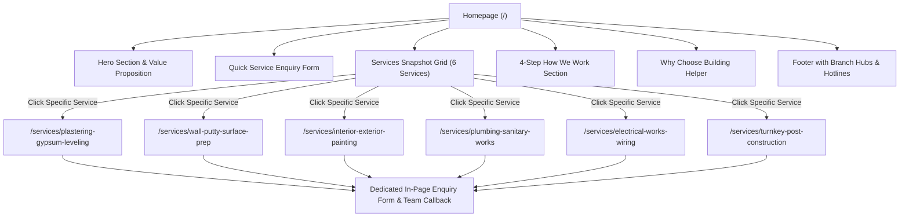

# Building Helper - Post-Construction Finishing Services Platform
## System Architecture & Specifications

> **Document Version**: 2.0 (Static Service Enquiry & Detail Showcase Architecture)  
> **Status**: Implemented  
> **Last Updated**: October 2026

---

## 1. Executive Summary

**Building Helper** is a modern, static web application designed specifically for customers and property owners requiring post-construction and building finishing services.

### Core Value Flow:
1. **Homepage Snapshot**: Visitors arrive on the homepage and get an immediate snapshot of the company's capabilities across the 5 core post-construction trades (Plastering & Gypsum Leveling, Wall Putty & Prep, Interior & Exterior Painting, Plumbing & Sanitary, Electrical Works & Wiring, and Complete Turnkey Post-Construction Package).
2. **Dedicated Service Deep-Dive**: Clicking any specific service redirects the user to that service's dedicated page (`/services/[slug]`) with in-depth technical specifications, scope of work, step-by-step execution stages, brand partner materials, quality standards, and trade-specific FAQs.
3. **Streamlined Enquiry Placement**: Visitors place an enquiry directly from the homepage or any service detail page (specifying property area, property type, contact details, preferred callback time, and notes).
4. **Team Callback & Site Inspection**: The technical engineering team receives the enquiry reference, calls the customer back during their preferred window, conducts a free on-site technical inspection, and executes the requirement under single-point accountability.
5. **Zero Feature Clutter**: All extraneous features (e-commerce cart, product catalog, contractor login modals, Net-30 credit ledgers, admin dashboards) have been completely stripped away, leaving a laser-focused, ultra-fast static website.

---

## 2. Tech Stack & Route Architecture

| Layer | Technology | Purpose |
| :--- | :--- | :--- |
| **Framework** | **Next.js 16 (App Router)** | Static site generation (`generateStaticParams`), instant client-side routing, and SEO metadata. |
| **Language** | **TypeScript 5** | Strict type safety across service definitions and inquiry models. |
| **Styling** | **Tailwind CSS 4** | Mobile-first responsive design, modern dark/light mode palette, and accessible typography. |
| **Icons** | **Lucide React** | Clean, lightweight SVG iconography for technical trades. |
| **State & Persistence** | **React Context + LocalStorage** | Instant form submission feedback, persistent enquiry tracking (`ENQ-2026-XXXX`), and toast notifications. |

---

## 3. Site Navigation & Routes

---

## 4. Retained Core Services (`src/data/servicesData.ts`)

1. **Plastering & Gypsum Leveling (`plastering-gypsum-leveling`)**:
   - Gyproc Saint-Gobain Elite 90 one-coat plastering
   - Laser plumb line leveling (±1mm tolerance)
   - RCC chemical hack-bonding (Gyproc Bond-It)
   - Fiber-mesh joint reinforcement and false ceiling fabrication

2. **Wall Putty & Surface Finishing (`wall-putty-surface-prep`)**:
   - Multi-coat polymer white cement putty (Birla WallCare / JK ProMax)
   - Motorized dust-free vacuum sanding (Mirka system)
   - Halogen grazing light inspection for zero undulation
   - Deep penetrating acrylic primer base seal

3. **Interior & Exterior Painting (`interior-exterior-painting`)**:
   - Asian Paints Royale Luxury Emulsion (computer-tinted)
   - Apex Ultima Protek exterior weatherproofing
   - Designer textures (Royale Play, Stucco, micro-cement)
   - Full site masking and zero paint splatter guarantee

4. **Plumbing & Sanitary Works (`plumbing-sanitary-works`)**:
   - Concealed hot and cold water supply (Astral / Supreme SDR-11 CPVC)
   - Ring-fit SWR drainage with laser slope alignment
   - Mandatory 24-hour hydraulic leak test at 10 bar before plaster closing
   - Concealed diverters, wall-hung WC frames, and designer faucets

5. **Electrical Works & Wiring (`electrical-works-wiring`)**:
   - Heavy mechanical rigid PVC conduit wall chases
   - Havells / Polycab FRLS flame-retardant multi-strand copper cables
   - Phase-balanced double-door distribution boards (Schneider / Legrand)
   - Dual 30mA RCCB electric shock protection

6. **Complete Post-Construction Package (`turnkey-post-construction`)**:
   - Turnkey 5-in-1 synchronized trade execution
   - Dedicated on-site Project Supervisor
   - Zero wall re-cutting through sequential civil-utility scheduling
   - Daily photographic updates and wholesale material billing

---

## 5. Enquiry Lifecycle

1. **User Input**: Customer specifies required services, property type (Apartment, Villa, Commercial), area in sq. ft., name, phone number, city, and preferred callback window.
2. **Instant Confirmation**: System generates a unique reference ID (e.g. `ENQ-2026-8492`), persists it to `localStorage`, and displays an immediate acknowledgment card confirming the time window.
3. **Team Callback**: The technical operations desk initiates a call to the client's phone number to review project blueprints and dispatch a site engineer for a free technical survey.
